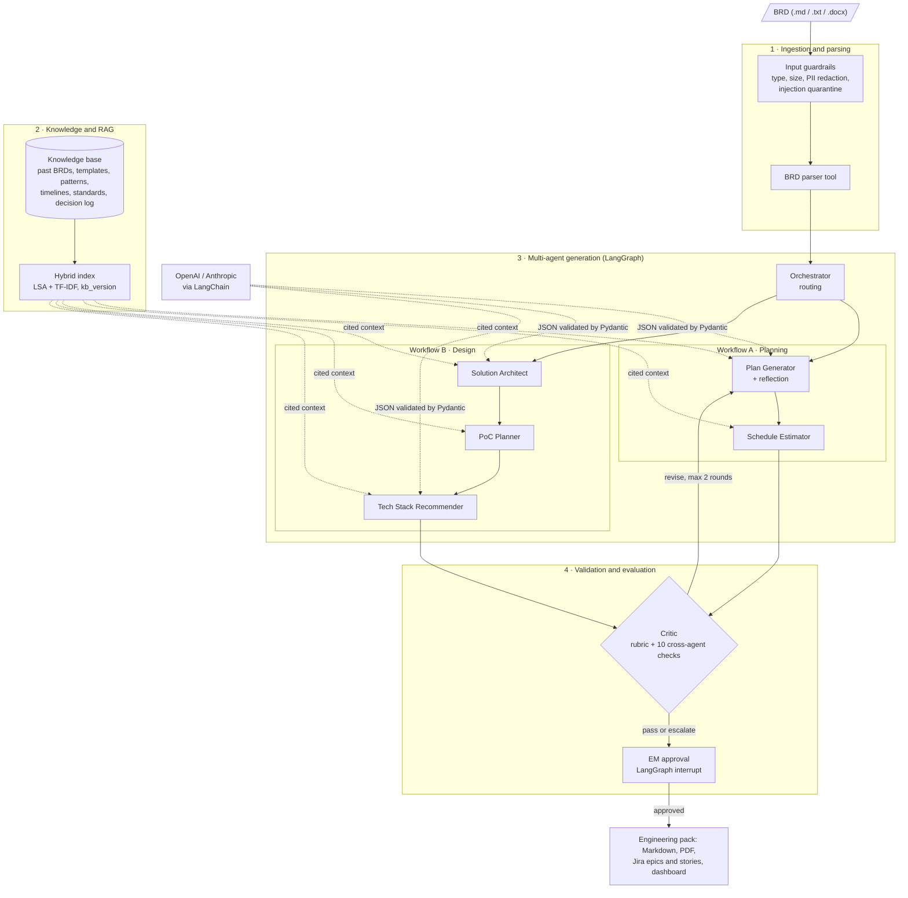
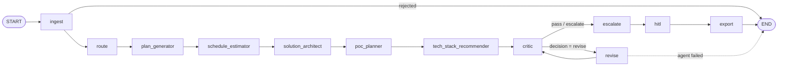

# Multi-Agent BRD-to-Engineering System

*A 7-agent LangGraph system that turns a Business Requirements Document into a decision-ready engineering pack for Engineering Managers.*

Capstone 1 (Applied Agentic AI for Engineering Managers). Turns a raw Business Requirements Document (BRD) into a decision-ready **engineering pack** — plan, schedule, architecture, PoC scope and tech-stack options — grounded in organisational knowledge (RAG), checked by a Critic with a bounded revision loop, badged GREEN / AMBER / RED, and gated by the Engineering Manager (EM) before anything is exported.

Built with **Python + LangGraph** (orchestration graph, Critic loop, human-in-the-loop interrupt) and **LangChain** chat models (`ChatOpenAI` / `ChatAnthropic`). Runs **fully offline** by default; OpenAI or Anthropic is opt-in.

> **Safety boundary:** use synthetic or anonymised BRDs. The default provider is deterministic and offline. An online provider receives (PII-redacted) BRD text, so it only runs after you explicitly confirm the endpoint is approved for the data (`--allow-external` / `BRD2ENG_ALLOW_EXTERNAL_CONTENT=1`). Never commit API keys, real BRDs or generated `outputs/`. Results on the small synthetic eval set are not evidence of production readiness.

## Quick start

```powershell
python -m pip install -e ".[openai,dev]"
python run_pipeline.py --rebuild-index
python run_pipeline.py eval_dataset/brds/E2_merchant_dispute_portal.md --auto-approve   # offline, no key needed
```

Open `outputs/<run_id>/dashboard.html` and `engineering_pack.md` to see the result. Details below.

**Contents:** [Requirements and setup](#requirements-and-setup) · [Run the end-to-end demo](#run-the-end-to-end-demo) · [Usage](#usage) · [Architecture](#architecture) · [Development](#development)

## Requirements and setup

- Python **3.11+** (developed on 3.12)
- An OpenAI API key — *optional*, only for live LLM runs (Anthropic also supported)
- Git, only if cloning

All dependencies are pinned in `pyproject.toml` (`langgraph`, `langchain-core`, `pydantic`, `numpy`, `scikit-learn`, `python-docx`, `reportlab`; extras: `openai` → `langchain-openai`, `anthropic` → `langchain-anthropic`, `dev` → `pytest`).

From the project folder (`brd2eng/`) in PowerShell:

```powershell
python -m venv .venv
.\.venv\Scripts\Activate.ps1              # if blocked: Set-ExecutionPolicy -Scope CurrentUser RemoteSigned
python -m pip install -e ".[openai,dev]"  # same as: pip install -r requirements.txt
python run_pipeline.py --rebuild-index    # chunk + embed the knowledge base (78 chunks), one-time
python -m pytest                          # 9 tests, offline
```

macOS / Linux: `source .venv/bin/activate`; everything else is the same.

### Configure OpenAI (optional)

Set the key **in the shell session only** — do not put it in code, notebooks or committed files.

```powershell
$env:OPENAI_API_KEY = "sk-..."
$env:BRD2ENG_ALLOW_EXTERNAL_CONTENT = "1"   # I confirm this endpoint is approved for the BRD data (or pass --allow-external)
# optional model routing (defaults: small = gpt-4.1-mini, large = gpt-4.1)
$env:BRD2ENG_SMALL_MODEL = "gpt-4.1-mini"   # orchestrator, schedule, PoC, critic
$env:BRD2ENG_LARGE_MODEL = "gpt-4.1"        # plan, architecture, tech stack, judge
```

| Variable | Purpose |
|---|---|
| `OPENAI_API_KEY` / `ANTHROPIC_API_KEY` | Provider credentials (read from the environment only) |
| `BRD2ENG_ALLOW_EXTERNAL_CONTENT=1` | Data-boundary opt-in; without it an online provider is refused before any BRD is read |
| `BRD2ENG_LLM_PROVIDER` | `openai` \| `anthropic` \| `offline` (default: detected from the key, else offline) |
| `BRD2ENG_SMALL_MODEL` / `BRD2ENG_LARGE_MODEL` | Model routing per tier |
| `BRD2ENG_LLM_BACKEND` | `langchain` (default when installed) \| `http` (plain urllib) |
| `BRD2ENG_LLM_CACHE=1` | Opt-in on-disk response cache (`.cache/llm/`, git-ignored): repeated runs and evals cost no tokens |
| `LANGSMITH_TRACING=true` + `LANGSMITH_API_KEY` | LangSmith traces of every LangGraph node and LLM call; only active with the data-boundary opt-in |
| `BRD2ENG_SIMULATE_TOOL_FAILURE=1` | Demo: first Jira call fails with a 503 and is retried |

## Run the end-to-end demo

**1. Offline (no key)** — deterministic, reproducible:

```powershell
python run_pipeline.py eval_dataset/brds/E2_merchant_dispute_portal.md --auto-approve
```

**2. With OpenAI through LangGraph:**

```powershell
python run_pipeline.py eval_dataset/brds/E2_merchant_dispute_portal.md --provider openai --allow-external
```

The graph runs: guardrails + parsing → routing → Plan → Schedule → Architecture → PoC → Tech Stack → Critic (up to 2 revision rounds) → escalation ticket → **HITL gate**. At the gate the graph pauses (LangGraph `interrupt()`), shows badges, scores and escalations, and points to the draft pack. Answer `a` (approve), `r` (reject) or `o` (override-approve RED). Only an approved pack is exported to PDF and Jira; a rejected one stays a draft. Add `--auto-approve` to skip the prompt (RED is still auto-rejected).

The final JSON line confirms the run, e.g. `"engine": "langgraph", "provider": "openai", "backend": "langchain"`.

**3. Inspect the outputs** in `outputs/<run_id>/`:

| File | What |
|---|---|
| `engineering_pack.md` / `.pdf` | The deliverable: badges, EM decisions needed, plan, schedule, architecture (Mermaid), PoC, stack options, assumptions, sources |
| `dashboard.html` | Open in a browser: badges, score per revision, cross-agent checks, Critic feedback by round, guardrails, per-agent tokens/cost/latency |
| `jira_export.json`, `jira_mock/` | Epics per phase + stories per requirement (mock Jira REST client), escalation ticket |
| `artifacts/*.rev{n}.json`, `critic.round{n}.json` | Every agent output per revision and every Critic report |
| `run_log.jsonl`, `summary.json` | Structured logs (hashes only — no BRD text, prompts or keys) and run metrics |

A complete sample run is committed at `outputs/sample_run_E2/`.

**Other inputs to try:** `E3_realtime_fraud_alerts.md` (Critic catches an under-sized schedule → escalated), `E5_loyalty_points_contradictions.md`, `G2_prompt_injection_pii.md` (injection quarantined, PII redacted), `G3_wrong_file_type.json` (rejected), or your own `.md` / `.txt` / `.docx`.

## Usage

`python run_pipeline.py [BRD] [options]`. The BRD can be `.md`, `.txt` or `.docx`.

| Option | What it does |
|---|---|
| *(no options)* | Offline run through LangGraph; pauses at the approval step and asks you to approve or reject |
| `--auto-approve` | Skip the approval prompt (RED packs are still rejected) |
| `--provider openai\|anthropic\|offline` | Choose the LLM provider (default: from `BRD2ENG_LLM_PROVIDER`, else from the API key, else offline) |
| `--allow-external` | Confirm the provider is approved for this BRD's data (required for OpenAI / Anthropic) |
| `--engine langgraph\|classic` | LangGraph graph (default) or the original plain-Python loop; identical outputs |
| `--profile tuned\|baseline` | Retrieval configuration (tuned: top-k 5, hybrid search, per-agent filters) |
| `--no-export` | Skip PDF and Jira export |
| `--label <prefix>` | Prefix for the run folder name |
| `--rebuild-index` | Re-chunk and re-embed the knowledge base |
| `--show-graph` | Print the LangGraph workflow as Mermaid and exit |

Other entry points:

| Command | What it does |
|---|---|
| `python run_evals.py [--profiles tuned baseline] [--provider openai --allow-external]` | Runs the 8-input eval suite and writes `eval_results/eval_report.md` (offline by default) |
| `python mcp_server.py` | MCP tool server over stdio exposing `parse_brd` and `search_knowledge_base` to other AI clients |
| `python -m src.tools.export_schemas` | Regenerates the agents' JSON Schemas in `docs/schemas/` |
| `python -m pytest` | 9 offline tests |

Using it from Python:

```python
from pathlib import Path
from src.config import RunOptions
from src.graph import GraphPipeline
from src.llm import LLMClient

state = GraphPipeline(RunOptions(auto_approve=True), llm=LLMClient(provider="offline")).run(
    Path("eval_dataset/brds/E2_merchant_dispute_portal.md"))
print(state.status, state.critic_reports[-1].overall_badge, state.run_dir)
```

## Architecture

### System layers

Four layers from the capstone reference architecture, with cross-cutting guardrails, observability and a human approval gate.



### LangGraph workflow

The graph compiled in `src/graph.py` (print it with `python run_pipeline.py --show-graph`):



`escalate` opens the Jira escalation ticket and writes the draft pack; `hitl` pauses the graph until the EM approves or rejects; `export` writes the PDF and Jira issues only for an approved pack. Any agent that still fails after retries ends the run without exporting.

### Workflows, agents, tools and actions

| Workflow | Agents (agent-to-agent hand-off) | Tools | Actions and decisions |
|---|---|---|---|
| Intake | Orchestrator | `read_document`, `brd_parser` | Decides routing of every requirement and the export targets |
| A · Planning | Plan Generator → Schedule Estimator | `kb_search` (templates, past BRDs, timelines) | Plan Generator picks the plan template and self-reviews (reflection); Schedule flags infeasible deadlines |
| B · Design | Solution Architect → PoC Planner → Tech Stack Recommender | `kb_search`, `standards_lookup`, `decision_log_lookup` | Architect ranks patterns; Tech Stack **decides which lookup tools to call** per component category |
| C · Validation | Critic → originating agents → EM | rubric scoring, grounding and scope checks | Critic decides pass / revise / escalate; Orchestrator **opens the escalation ticket on its own**; export to Markdown, PDF, Jira after approval |

- **Orchestration — LangGraph** (`src/graph.py`). A `StateGraph` owns control flow and routing state (status, Critic round, decision, revision targets, HITL decision). The Critic loop is a conditional edge; the revise step re-runs flagged agents plus their dependents in dependency order. The HITL node pauses with an `InMemorySaver` checkpoint (`thread_id = run_id`) and resumes with `Command(resume=<EM decision>)`. Stage logic lives in `Pipeline` (`src/agents/orchestrator.py`) and is shared with the classic engine.
- **Prompts** (`src/prompts.py`). Every agent uses one Agent Prompt Template: ROLE, SCOPE, FORMAT, CONSTRAINTS, COMMAND, TOOL GUIDANCE, OUTPUT STRUCTURE, TONE, plus shared grounding and scope rules.
- **LLM calls — LangChain** (`src/llm.py`). `ChatOpenAI` (JSON mode) / `ChatAnthropic` with per-agent model routing. Every call must return JSON that validates against the agent's Pydantic contract; malformed or invalid output is re-prompted twice with the errors, then falls back to the deterministic engine and is flagged in the log. Token usage, cost and cache hits are recorded per agent; LangSmith tracing is available behind the data-boundary opt-in.
- **Contracts — Pydantic** (`src/contracts.py`, JSON Schemas in `docs/schemas/`). Each handoff is validated by the consumer before it is routed downstream.
- **RAG** (`src/rag/`). Knowledge base of 6 source types (past BRDs, plan templates, architecture patterns, project timelines, engineering standards, tech decision log) → heading-aware chunks with metadata → hybrid dense (LSA) + sparse (TF-IDF) retrieval with per-agent source filters. Every claim carries chunk-id citations; no hits → disclaimer and assumption flags.
- **Guardrails** (`src/guardrails.py`). File type/size/content checks, PII redaction, prompt-injection quarantine, handoff validation, grounding and scope checks, opt-in data boundary for online providers.
- **Tools.** BRD parser, Markdown/PDF exporters, mock Jira client with retries (`src/tools/`), MCP server (`mcp_server.py`: `parse_brd`, `search_knowledge_base`).

### The seven agents

| # | Agent | Group | One job | Output contract |
|---|---|---|---|---|
| 1 | Orchestrator | Orchestration | Route requirements, manage state, retries, revision loop, escalations, HITL, exports | `RoutingDecision` |
| 2 | Engineering Plan Generator | Planning | Phases, milestones, risks, team — from the best-fit org template, with a Reflection self-review | `EngineeringPlan` |
| 3 | Schedule Estimator | Planning | Effort, durations, p50/p80 from past-project analogs; deadline feasibility | `Schedule` |
| 4 | Solution Architect | Design | Pattern vs alternatives, components, data flows, NFR→mechanism mapping, Mermaid | `Architecture` |
| 5 | PoC Planner | Design | Riskiest components, measurable success criteria, go/no-go | `PoCPlan` |
| 6 | Tech Stack Recommender | Design | 2–3 scored options (scalability, familiarity, integration risk, cost) | `TechStackRecommendation` |
| 7 | Critic | Validation | 4-dimension rubric, 10 cross-agent checks, grounding/scope checks, targeted feedback, revise/escalate decision | `CriticReport` |

### Results at a glance (offline, tuned profile — `docs/04_evaluation_report.md`)

- 8 eval inputs (simple / medium / complex / missing-NFR / contradictions / 3 guardrail attacks): **44/44 expected-outcome checks pass**; malformed and wrong-type inputs rejected; injection quarantined, PII redacted.
- Every completed BRD goes **AMBER → GREEN in one Critic round**; cross-agent contradictions → 0.
- RAG tuning (baseline → tuned): **round-0 groundedness 82.5% → 93.3%, Critic issues −45%, RED first drafts 4/6 → 0/6.**
- Critic vs reviewer calibration: MAE 0.44 / 5, verdict agreement 94%; scikit-learn precision 1.0, recall 0.71, F1 0.83 on "needs revision" verdicts.

More detail: [PRFAQ](docs/10_prfaq.md) · [Strategy, plan & leadership asks](docs/11_strategy_and_plan.md) · [Architecture](docs/01_architecture.md) · [Agent contracts](docs/02_agent_contracts.md) · [RAG design](docs/03_rag_design.md) · [Evaluation report](docs/04_evaluation_report.md) · [Guardrails & safety](docs/05_guardrails_safety.md) · [Operationalization](docs/06_operationalization.md) · [Decision justification](docs/07_decision_justification.md) · [Demo script](docs/08_demo_script.md) · [Rubric traceability + course guideline compliance](docs/09_rubric_traceability.md)

## Development

```powershell
python -m pytest                       # 9 tests, always offline (even if an API key is set)
python run_evals.py                    # eval suite, both retrieval profiles, offline -> eval_results/eval_report.md
python run_evals.py --profiles tuned --provider openai --allow-external   # live-LLM eval (costs tokens)
python run_pipeline.py --show-graph    # regenerate the graph diagram
python -m src.tools.export_schemas     # regenerate JSON Schemas -> docs/schemas/
```

Tests cover the end-to-end run, input rejection, PII redaction and injection quarantine, contract violations, LLM retry → fallback, LangGraph/classic parity, the HITL interrupt/resume path, the external-provider opt-in, and the response cache + tracing gate.

### Repository structure

```
run_pipeline.py          CLI: one BRD end-to-end (LangGraph by default)
run_evals.py             eval harness -> eval_results/
mcp_server.py            MCP tool server (JSON-RPC over stdio)
pyproject.toml           pinned dependencies, extras, pytest config
src/
  graph.py               LangGraph StateGraph (critic loop, HITL interrupt)
  llm.py                 LangChain/HTTP client for OpenAI/Anthropic, offline engine, contract enforcement, data-boundary gate
  contracts.py           Pydantic output contracts for all agents
  config.py              thresholds, retrieval profiles, model routing, prices
  prompts.py             agent system prompts + shared rules
  guardrails.py          input validation, redaction, injection quarantine, handoff/grounding/scope checks
  run_logger.py          JSONL logging with hashes, per-agent spans
  report.py              HTML dashboard
  agents/                orchestrator (Pipeline stages), plan_generator, schedule_estimator, solution_architect,
                         poc_planner, tech_stack, critic, base
  parsing/  rag/  tools/  evals/
knowledge_base/          synthetic organisational knowledge (6 source types)
eval_dataset/            BRDs, expected outcomes, Critic calibration set
docs/                    documentation package + JSON schemas
tests/                   pytest suite
```

### Conventions

- **Adding or changing an agent:** define its output model in `src/contracts.py`, its prompt in `src/prompts.py`, the class in `src/agents/` (implement `retrieve` and an offline `heuristic`), register it in `AGENT_CLASSES` / `WORKFLOWS` / `DEPENDENTS` in `orchestrator.py` — `src/graph.py` builds a node for every agent in `WORKFLOWS` automatically. Re-export schemas and add a test.
- Every claim needs a knowledge-base citation or an explicit assumption; the Critic enforces this.
- Keep the offline path working — tests and evals must run without network or keys.
- Logs store hashes only: never log BRD text, prompts or credentials.
- Use synthetic fixtures only. Do not commit API keys, `.env`, real BRDs or `outputs/` (except `outputs/sample_run_E2/`).

### Known limitations

- The offline engine is a deterministic stand-in for LLM reasoning (formulaic prose, strong traceability). The LangChain/OpenAI path is tested with mocked models; run a live check with your own key.
- Offline, the LLM-as-Judge is a labelled heuristic proxy that shares logic with the Critic.
- Synthetic knowledge base and eval set; replace with your organisation's sanitised BRDs, templates and history for real use.
- Regex-based PII/injection detection; add an NER PII detector for production.
- HITL checkpoints are in-memory (single process); use a persistent LangGraph checkpointer (e.g. SQLite/Postgres) for multi-user or resumable runs.
