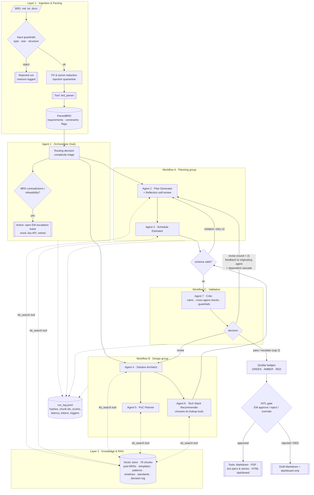

# 1. Architecture Overview

**Tool track:** code (Python 3.11+, **LangGraph** for orchestration, **LangChain** chat models for LLM calls, pydantic v2, scikit-learn, numpy, reportlab). The workflow is a LangGraph `StateGraph` (`src/graph.py`); stage logic lives in `Pipeline` (`src/agents/orchestrator.py`), so every hand-off, retry and revision stays explicit and testable. `--engine classic` runs the same stages as a plain-Python loop with identical outputs.

**LLM providers:** OpenAI (`ChatOpenAI`) or Anthropic (`ChatAnthropic`) through LangChain, opt-in behind a data-boundary confirmation (with model routing: small model for routing/critic/scheduling, large model for planning/architecture/stack). Without a key the system runs in **offline mode**: every agent has a deterministic heuristic generator that honours the same output contract. This makes the whole pipeline, eval suite and demo reproducible on any laptop, and doubles as the fallback when an LLM keeps violating its contract.

## 1.1 System diagram (workflows → agents → tools → actions, with error paths)



## 1.2 Layers

| Layer | Implementation | Key files |
|---|---|---|
| 1. BRD ingestion & parsing | File/structure validation, PII/secret redaction, prompt-injection quarantine, deterministic section + requirement parser (IDs, priorities, categories, sub-categories), constraint extraction, ambiguity / contradiction / missing-section flags | `src/guardrails.py`, `src/parsing/brd_parser.py` |
| 2. Knowledge augmentation (RAG) | Source-aware chunking, LSA dense + TF-IDF sparse hybrid embeddings, numpy vector store with metadata filters, per-agent provenance registry | `src/rag/` |
| 3. Multi-agent generation | 5 specialists in two workflows, each with one output contract | `src/agents/*.py` |
| 4. Validation & evaluation | Critic (rubric, cross-agent checks, grounding/scope guardrails, revision loop), badges, HITL gate, eval harness | `src/agents/critic.py`, `src/evals/`, `run_evals.py` |

## 1.3 Orchestration pattern: hub-and-spoke with a bounded revision edge

**Choice.** Hub-and-spoke: the Orchestrator owns all state (`PipelineState`), dispatches to specialists, validates every hand-off, aggregates results and drives the Critic loop. The only "graph-like" edge is Critic → originating agent, bounded at 2 cycles.

**Why it fits.**
- The 7 agents have clear, stable responsibilities and a mostly linear dependency order (plan → schedule; architecture → PoC, stack). A hub keeps that order explicit and makes each hop loggable and testable.
- The brief mandates central concerns that belong in one place: state, retries, the revision cap, cross-agent consistency, the HITL gate.
- It is the easiest pattern to explain to stakeholders and to debug: every agent run is one `agent_execution` log line with input hash, chunks, output hash, latency and triggers.

**Alternatives considered.** *Sequential pipeline* — simpler, but cannot re-run only the agents the Critic flags. *Hierarchical* (Planning and Design sub-coordinators) — useful at larger scale but adds a coordination layer we do not need for 5 specialists. *Message graph* — natural for the revision loop but harder to reason about; the bounded revision edge gives us the one loop we need without a general graph.

**Implementation: LangGraph.** The hub-and-spoke flow runs as a LangGraph `StateGraph`; the Critic → revise → Critic loop is a conditional edge, i.e. the one message-graph cycle we need, with the explicit cap the playbook asks for (the Critic returns `escalate` at round 2). The HITL gate is a LangGraph `interrupt()`: the graph checkpoints (`InMemorySaver`, `thread_id = run_id`) and resumes with the EM's decision. `python run_pipeline.py --show-graph` prints the compiled graph:

```
START → ingest ─(rejected)→ END
      → route → plan_generator → schedule_estimator → solution_architect → poc_planner → tech_stack_recommender
      → critic ─(revise, ≤ 2 rounds)→ revise → critic
               └→ escalate → hitl (interrupt / resume) → export → END
      any agent node ─(failed after retries)→ END
```

**Watch-out and mitigation.** The hub can become a "god object". Mitigation: the Orchestrator contains no domain logic — it only routes, validates, retries and persists; all reasoning lives in agents with their own contracts.

## 1.4 State, routing and the revision cascade

- **Routing (Agent 1 output `RoutingDecision`).** Functional + integration + constraint requirements → Plan; constraints → Schedule; functional + NFR + integration → Architect; integrations, critical NFRs and ambiguous Musts → PoC; NFR + integration → Tech Stack. A deterministic safety net routes any unrouted requirement to the Plan Generator and logs a trigger.
- **Initial complexity** is a quick size-based triage. The Architect later sets the authoritative complexity; when they differ, the Critic's cross-agent checks (`schedule_matches_architecture_complexity`, `plan_template_fits_architecture`) send targeted feedback.
- **Fix memory.** Critic issues accumulate per agent, so a re-run never "forgets" an earlier fix.
- **Dependency cascade.** When an agent is revised, its dependents re-run too (plan → schedule, PoC; architecture → PoC, stack; schedule → PoC, stack), in topological order, so the final artifact set is consistent.

## 1.5 Error handling and fallbacks

| Failure | Handling |
|---|---|
| Malformed / unsupported input | Rejected before any agent runs; reasons logged; run status `rejected` |
| LLM returns non-JSON or schema-invalid JSON | Re-prompt with the validation errors (up to 2 retries), then fall back to the heuristic generator and flag `llm_fallback_to_heuristic` |
| LLM transport error / timeout | Counted as a failed attempt; same retry → fallback path |
| Contract violation at a hand-off | `ContractViolation` logged; agent retried up to 2 times; persistent failure stops the run with status `failed:<agent>` (no partial pack is exported) |
| No RAG hits for an agent | Proceed with an explicit disclaimer in the artifact's assumptions; groundedness then fails, so the badge cannot be GREEN |
| Critic loop does not converge | Hard cap at 2 revision rounds → decision `escalate`, AMBER/RED badge shown to the EM |
| External tool (Jira) transient error | `call_tool` retries with exponential backoff (demo: `BRD2ENG_SIMULATE_TOOL_FAILURE=1`) |
| BRD contradictions / infeasible deadline | Never resolved silently: conservative default applied + documented, EM escalation ticket opened automatically |

## 1.6 Capstone requirement mapping (from the Week-1 playbook)

| Requirement | Where |
|---|---|
| ≥ 2 workflows | Workflow A (Planning: Plan Generator → Schedule Estimator), Workflow B (Design: Architect → PoC Planner + Tech Stack), Workflow C (Validation: Critic → HITL → exports) |
| ≥ 2 agents per workflow, agent-to-agent interaction | Schedule consumes the Plan; PoC and Stack consume the Architecture; Critic feedback flows back to originating agents |
| Agent → Tool | `kb_search`, `brd_parser`, `jira_create_issue`, `export_markdown/pdf/jira` (all via `call_tool`, logged) |
| Agent → Action (independent) | Orchestrator opens the EM escalation ticket without waiting for the human gate (it informs; it never changes scope) |
| Agent → Decision | Tech Stack Recommender decides which lookup tools to call from the architecture's component categories; Orchestrator decides routing and export targets; Architect ranks patterns; Plan Generator chooses the template |
| External evaluation frameworks | scikit-learn metrics (precision / recall / F1 / Cohen's kappa for Critic calibration), LangSmith tracing (opt-in), pydantic/JSON-Schema contracts, ROUGE-L reference scoring, LLM-as-Judge, rule-based checks (see `04_evaluation_report.md`) |
| Optimization | Retrieval tuning baseline → tuned (measured), model routing, prompt template, opt-in response cache; fine-tuning deliberately not used (`07_decision_justification.md`) |

## 1.7 Scaling to 50+ BRDs per week

At ~10 BRDs/day the design holds, with these changes:
1. **Queue + workers:** put BRDs on a queue (SQS); run each pipeline in a stateless worker; persist `PipelineState` to a database instead of the run folder.
2. **Vector DB:** move from the in-process numpy store to a managed vector DB (Qdrant/pgvector/OpenSearch k-NN) with the same metadata schema; schedule incremental re-indexing as approved packs are fed back into the knowledge base (closing the learning loop).
3. **Parallelism:** Planning and Design workflows are independent until the Critic, so they can run concurrently (cuts wall-clock ~40%).
4. **Cost controls:** keep model routing; cache retrievals and Critic verdicts by content hash; skip re-running unchanged agents.
5. **Hierarchical orchestration** becomes worthwhile if specialist count grows (e.g. security architect, data architect) — sub-coordinators per group keep the hub thin.
6. **Monitoring:** ship `run_log.jsonl` to the log platform and alert on the SLOs in `06_operationalization.md`.
