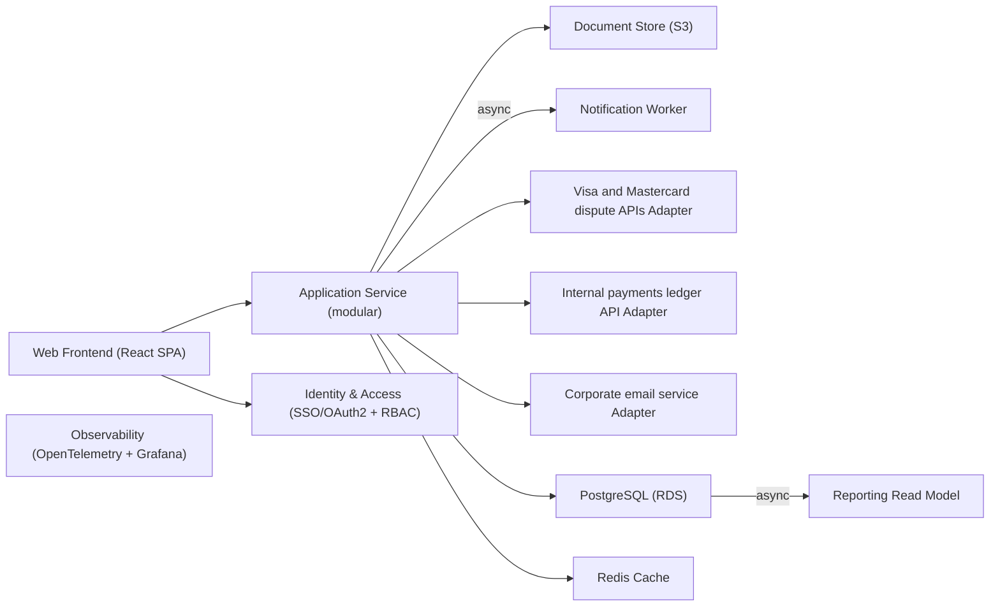

# Engineering Pack — Merchant Dispute Resolution Portal

Run `demo-20261027-081205-2ed5b3` · BRD `BRD-6d8e14e4` · classification **confidential** · overall 🟢 **GREEN** (4.95/5) after 1 revision round(s) · HITL: **approved**

## Quality badges

| Artifact | Badge | Overall | Grounded (cited) | Coverage | Contradictions | Actionability |
|---|---|---|---|---|---|---|
| plan_generator | 🟢 GREEN | 5.0 | 91% | 100% | 0 | 5.0 |
| schedule_estimator | 🟢 GREEN | 5.0 | 100% | 100% | 0 | 5.0 |
| solution_architect | 🟢 GREEN | 4.75 | 90% | 100% | 0 | 5.0 |
| poc_planner | 🟢 GREEN | 5.0 | 100% | 100% | 0 | 5.0 |
| tech_stack_recommender | 🟢 GREEN | 5.0 | 100% | 100% | 0 | 5.0 |

## ⚠️ Decisions needed from the EM

- **SCH-1** (feasibility, high): p50 estimate 23.5 weeks exceeds the BRD deadline of 20 weeks (p80 28). A Must-only first release is estimated at 19 weeks. — *Default applied:* Escalated to EM: choose between extending the date, adding capacity, or a Must-only first release; schedule keeps the conservative (longer) estimate.

## 1. Engineering plan

Template: `T1` · Team: 7 engineers

### PH1 Discovery & Design (15% effort) `[tmpl:T1#2]`
*Objective:* Discovery & Design for Merchant Dispute Resolution Portal
- refined backlog with acceptance criteria
- architecture decision records
- UX flows
- integration sandbox access confirmed
- clarified acceptance criteria for ambiguous requirements NFR-06
*Exit criteria:* architecture review board sign-off; every Must requirement has acceptance criteria; integration credentials obtained

### PH2 Foundation & Platform Setup (15% effort) `[tmpl:T1#3]`
*Objective:* Foundation & Platform Setup for Merchant Dispute Resolution Portal, delivering 1 mapped requirements _(BRD: CON-03)_
- repositories
- CI/CD pipeline
- environments (dev/stage/prod)
- IaC
- authentication skeleton
- observability baseline
- CON-03 (constraint): Must run on the org AWS platform.
*Exit criteria:* a hello-world service deploys to stage through the pipeline with SSO login and dashboards

### PH3 Core Build (40% effort) `[tmpl:T1#4]`
*Objective:* Core Build for Merchant Dispute Resolution Portal, delivering 10 mapped requirements _(BRD: FR-01, FR-02, FR-03, FR-04, FR-05, FR-06, FR-07, FR-08, FR-09, FR-10)_
- Must-have functional requirements implemented behind feature flags with unit and contract tests
- FR-01 (must): Merchants sign in and see a list of their open and closed…
- FR-02 (must): Merchants upload evidence documents (PDF, JPG, PNG up to 20 MB each)…
- FR-03 (must): The system submits the evidence package to the card network dispute…
- FR-04 (must): Chargeback notifications from the card networks are ingested and…
- FR-05 (must): Operations analysts work a case queue, assign cases, add internal…
- FR-06 (must): Email notifications to merchants when a chargeback is created, 3…
- FR-07 (should): Analysts see a dashboard of disputes by status, reason code, win…
- FR-08 (should): Merchants can accept liability for a chargeback with one click,…
- FR-09 (must): Dispute outcomes (won or lost) are posted to the internal payments…
- FR-10 (could): Bulk evidence upload for merchants with many disputes.
*Exit criteria:* all Must stories accepted by product owner in stage; test coverage at least 80% on domain logic; acceptance tests pass for FR-01, FR-02, FR-03, FR-04, FR-05, FR-06, FR-09

### PH4 Integration & Hardening (20% effort) `[tmpl:T1#5]`
*Objective:* Integration & Hardening for Merchant Dispute Resolution Portal, delivering 3 mapped requirements _(BRD: INT-01, INT-02, INT-03)_
- end-to-end integration with external systems
- performance and security testing
- NFR verification
- INT-01 (must): Visa and Mastercard dispute APIs (REST, certification required).
- INT-02 (must): Internal payments ledger API.
- INT-03 (must): Corporate email service.
*Exit criteria:* NFR targets met in a performance test; no open critical or high security findings; UAT sign-off

### PH5 Launch & Hypercare (10% effort) `[tmpl:T1#6]`
*Objective:* Launch & Hypercare for Merchant Dispute Resolution Portal, delivering 1 mapped requirements _(BRD: CON-01)_
- production rollout plan
- runbooks
- on-call rota
- two weeks of hypercare
*Exit criteria:* go-live checklist complete; error budget healthy for 14 days; handover to operations

**Milestones**

| ID | Milestone | Phase | Target (p50) | Acceptance |
|---|---|---|---|---|
| M1 | Architecture approved `[tmpl:T1#7]` | PH1 | end of week 3.5 | architecture review board sign-off |
| M2 | Walking skeleton in stage `[tmpl:T1#7]` | PH2 | end of week 7 | a hello-world service deploys to stage through the pipeline with SSO login and dashboards |
| M3 | Feature complete `[tmpl:T1#7]` | PH3 | end of week 16.5 | all Must stories accepted by product owner in stage |
| M4 | UAT sign-off and NFRs verified `[tmpl:T1#7]` | PH4 | end of week 21 | NFR targets met in a performance test |
| M5 | Production go-live `[tmpl:T1#7]` | PH5 | end of week 23.5 | go-live checklist complete |

**Risks**

| ID | Risk | L/I | Mitigation | Owner |
|---|---|---|---|---|
| R1 | Security review blocks launch `[tmpl:T1#8]` | medium/medium | threat model in Phase 1, SAST/DAST in CI, early AppSec review | Security Champion |
| R2 | Performance NFRs missed late in the project `[tmpl:T1#8]` | medium/high | load-test the walking skeleton in Phase 2 and every sprint thereafter | Tech Lead |
| R3 | Third-party or ERP integration sandbox unavailable or late `[tmpl:T1#8]` | medium/medium | request sandbox in week 1, build contract-test stubs, make integration the first PoC slice | Engineering Manager |
| R4 | INT-01 Visa and Mastercard dispute APIs (REST, certification…: sandbox access, certification or contract changes delay delivery _(BRD: INT-01)_ `[timeline:P-05]` `[tmpl:T1#2]` | medium/high | Request sandbox/credentials in discovery week 1, build contract-test stubs, isolate behind an adapter (anti-corruption layer), make it a PoC slice | Tech Lead |
| R5 | INT-02 Internal payments ledger API.: sandbox access, certification or contract changes delay delivery _(BRD: INT-02)_ `[tmpl:T1#2]` `[pbrd:PB-001#4]` | medium/high | Request sandbox/credentials in discovery week 1, build contract-test stubs, isolate behind an adapter (anti-corruption layer), make it a PoC slice | Tech Lead |
| R6 | INT-03 Corporate email service.: sandbox access, certification or contract changes delay delivery _(BRD: INT-03)_ `[tmpl:T1#2]` `[pbrd:PB-001#4]` | medium/high | Request sandbox/credentials in discovery week 1, build contract-test stubs, isolate behind an adapter (anti-corruption layer), make it a PoC slice | Tech Lead |
| R7 | Ambiguous requirement NFR-06 causes rework _(BRD: NFR-06)_ `[tmpl:T1#8]` | medium/medium | Acceptance criteria agreed with product owner before build; conservative interpretation recorded | Product Manager |

**Team**

- 1 × Tech Lead — owns architecture decisions and integration design `[tmpl:T1#2]`
- 1 × Frontend Engineer — builds the user-facing UI requirements
- 1 × QA / Test Automation Engineer — contract, end-to-end and performance test automation `[tmpl:T1#5]`
- 1 × DevOps / SRE Engineer — CI/CD, IaC, observability and SLO alerting `[tmpl:T1#3]`
- 3 × Backend Engineer — domain services and integrations

*Reflection self-review:* 0 issue(s) found; no changes needed

## 2. Schedule

p50 **23.5 weeks**, p80 **28 weeks**, 164 person-weeks, complexity basis 4, deadline 20 weeks → DOES NOT FIT

| Phase | Weeks | Start–End | Effort (pw) | Roles | Basis |
|---|---|---|---|---|---|
| PH1 Discovery & Design | 3.5 | w0–w3.5 | 24.6 | Tech Lead, Product Manager | 15% of 164 person-weeks; 8.9 person-weeks per requirement (median of analog projects P-05, P-06, P-11, complexity basis 4) with 7 engineers `[timeline:P-05]` `[timeline:P-06]` |
| PH2 Foundation & Platform Setup | 3.5 | w3.5–w7 | 24.6 | DevOps / SRE Engineer, Tech Lead, Backend Engineer | 15% of 164 person-weeks; 8.9 person-weeks per requirement (median of analog projects P-05, P-06, P-11, complexity basis 4) with 7 engineers `[timeline:P-05]` `[timeline:P-06]` |
| PH3 Core Build | 9.5 | w7–w16.5 | 65.6 | Backend Engineer, Frontend Engineer, QA / Test Automation Engineer | 40% of 164 person-weeks; 8.9 person-weeks per requirement (median of analog projects P-05, P-06, P-11, complexity basis 4) with 7 engineers `[timeline:P-05]` `[timeline:P-06]` |
| PH4 Integration & Hardening | 4.5 | w16.5–w21 | 32.8 | QA / Test Automation Engineer, Backend Engineer, DevOps / SRE Engineer | 20% of 164 person-weeks; 8.9 person-weeks per requirement (median of analog projects P-05, P-06, P-11, complexity basis 4) with 7 engineers `[timeline:P-05]` `[timeline:P-06]` |
| PH5 Launch & Hypercare | 2.5 | w21–w23.5 | 16.4 | DevOps / SRE Engineer, Tech Lead | 10% of 164 person-weeks; 8.9 person-weeks per requirement (median of analog projects P-05, P-06, P-11, complexity basis 4) with 7 engineers `[timeline:P-05]` `[timeline:P-06]` |

Analogs: P-05 (cx 4, 19 wks, team 7, +19%), P-06 (cx 4, 21 wks, team 7, +17%), P-11 (cx 4, 17 wks, team 6, +21%)

## 3. Solution architecture

**Pattern:** Modular Monolith `[pattern:modular-monolith]` `[pattern:search-centric]` — Selected Modular Monolith (retrieval 0.11, 2 signals, one team, transactional workflow). Trade-offs: simplest to build, test and operate; one deploy pipeline. Weaker independent scaling and fault isolation; modules must be policed to avoid a big ball of mud. Can later be split along module boundaries (strangler).

Alternatives considered: Search-Centric (Index + Retrieval) (score 0.28; retrieval 0.14, 2 signals, no search requirements); Layered (N-tier) (score 0.08; retrieval 0.04, 0 signals)

Complexity: 4/5

| ID | Component | Category | Responsibility | BRD |
|---|---|---|---|---|
| C1 | Web Frontend (React SPA) `[pattern:search-centric]` `[pattern:layered]` | frontend (feature) | user-facing screens for FR-01, FR-02, FR-07, FR-10 | FR-01, FR-02, FR-07, FR-10 |
| C2 | Application Service (modular) `[pattern:modular-monolith]` `[pattern:layered]` | service (feature) | domain modules and REST API for FR-01, FR-02, FR-03, FR-05, FR-08, FR-09, FR-10 | FR-01, FR-02, FR-03, FR-05, FR-08, FR-09, FR-10 |
| C3 | Document Store (S3) `[pattern:serverless]` `[pattern:search-centric]` | storage (feature) | encrypted object storage for uploaded documents with malware scanning | FR-02, FR-10 |
| C4 | Notification Worker `[pattern:event-driven]` `[pattern:modular-monolith]` | worker (feature) | asynchronous email/SMS/push dispatch with templates and retries | FR-06, INT-03 |
| C5 | Reporting Read Model `[pattern:cqrs]` | analytics (feature) | read-optimised projections for dashboards and exports (CQRS-lite) | FR-07 |
| C6 | Visa and Mastercard dispute APIs Adapter | integration (feature) | anti-corruption layer for Visa and Mastercard dispute APIs: auth, mapping, retries, contract tests | FR-03, FR-04, FR-09, INT-01 |
| C7 | Internal payments ledger API Adapter `[std:STD#4]` | integration (feature) | anti-corruption layer for Internal payments ledger API: auth, mapping, retries, contract tests | FR-09, INT-02 |
| C8 | Corporate email service Adapter `[std:STD#4]` | integration (feature) | anti-corruption layer for Corporate email service: auth, mapping, retries, contract tests | INT-03 |
| C9 | Identity & Access (SSO/OAuth2 + RBAC) `[std:STD#4]` | auth (feature) | authentication via corporate SSO/OAuth2 and role-based authorisation | FR-01, NFR-03, NFR-04 |
| C10 | PostgreSQL (RDS) `[pattern:event-driven]` `[std:STD#5]` | database (feature) | system of record for domain state and the append-only audit log | NFR-05 |
| C11 | Redis Cache `[pattern:cqrs]` | cache (feature) | hot-read cache for latency-critical lookups | NFR-01 |
| C12 | Observability (OpenTelemetry + Grafana) `[std:STD#6]` | observability (enabler) | traces, metrics, structured logs without PII, SLO alerts |  |

**NFR mapping**

| NFR | Mechanism | Components |
|---|---|---|
| NFR-01 | Redis cache for hot reads, stateless services with horizontal autoscaling on latency, load test at 2x target load before launch | C1, C11, C2 |
| NFR-02 | Multi-AZ deployment with health checks and rolling deploys; retries with backoff and dead-letter handling for asynchronous work; SLO burn-rate alerts `[std:STD#6]` `[pattern:event-driven]` | C10, C2 |
| NFR-03 | Corporate SSO (OIDC) and OAuth2 for external users, RBAC enforced in the service layer, KMS encryption at rest, TLS 1.2+ in transit, secrets in Secrets Manager, card data tokenised via the payments vault `[std:STD#4]` | C10, C2, C3, C9 |
| NFR-04 | Corporate SSO (OIDC) and OAuth2 for external users, RBAC enforced in the service layer, KMS encryption at rest, TLS 1.2+ in transit, secrets in Secrets Manager, card data tokenised via the payments vault `[std:STD#4]` | C10, C2, C3, C9 |
| NFR-05 | Append-only audit log table with retention policy and immutable backups; access logged and reviewed `[pattern:event-driven]` | C10, C2 |
| NFR-06 | Org design-system components and moderated usability testing of the primary flow `[std:STD#1]` | C1 |

## 4. Proof of concept

**Objective:** De-risk Visa and Mastercard dispute APIs Adapter, Internal payments ledger API Adapter, Corporate email service Adapter, Redis Cache before Core Build by proving the riskiest requirements against measurable targets.

Duration: 3 weeks · Components: C6, C7, C8, C11

| ID | Metric | Target | Measurement | Measurable |
|---|---|---|---|---|
| SC-NFR-01 | Portal pages load in under 2 seconds at p95 for 500 concurrent… `[tmpl:T2#3]` | under 2 seconds at p95; 500 concurrent merchants | load test with k6 in a production-like environment | ✅ |
| SC-NFR-02 | 99.9% monthly availability for the merchant portal. `[std:STD#5]` | 99.9% | synthetic probes over a 7-day soak test | ✅ |
| SC-NFR-06 | primary-flow task success `[tmpl:T2#9]` `[tmpl:T2#3]` | >= 90% task completion and median time-on-task <= 3 min with 5 target users | moderated usability test with the product owner | ✅ |
| SC-INT-01 | End-to-end round trip with Visa and Mastercard dispute APIs sandbox `[tmpl:T2#9]` | >= 95% of 50 contract-test cases pass; p95 < 1 s | contract tests against the sandbox in CI | ✅ |
| SC-INT-02 | End-to-end round trip with Internal payments ledger API sandbox `[tmpl:T2#9]` | >= 95% of 50 contract-test cases pass; p95 < 1 s | contract tests against the sandbox in CI | ✅ |
| SC-INT-03 | End-to-end round trip with Corporate email service sandbox `[tmpl:T2#9]` | >= 95% of 50 contract-test cases pass; p95 < 1 s | contract tests against the sandbox in CI | ✅ |

**Go / no-go:** Go to Core Build if every measurable Must criterion is met; otherwise the Solution Architect revisits the pattern/stack and the EM re-baselines the schedule.

## 5. Tech stack options

Weights: {'scalability': 0.2, 'team_familiarity': 0.35, 'integration_risk': 0.25, 'cost': 0.2}

| Option | Scal. | Familiarity | Integr. risk | Cost | Score | Approved |
|---|---|---|---|---|---|---|
| ⭐ OPT-A Org golden path (containers + managed AWS data services) | 4 | 5 | 2 | 3 | 4.15 | yes |
| OPT-B Serverless-first (Lambda + managed services) | 4 | 3 | 3 | 2 | 3.4 | yes |
| OPT-C Python lean stack | 3 | 4 | 2 | 3 | 3.6 | yes |

**OPT-A Org golden path (containers + managed AWS data services)** `[std:STD#1]` `[std:STD#2]` `[decision:TD-14]` — backend: Java 21 + Spring Boot 3, frontend: React 18 + TypeScript, database: PostgreSQL 16 (RDS), runtime: ECS Fargate, iac: Terraform, cache: Redis (ElastiCache), messaging: Amazon SQS/SNS, storage: Amazon S3
Pros: high team familiarity (avg 4.4/5 on the org matrix); entirely on the org approved list; no ARB exception needed; comfortable headroom for growth
Cons: standard operational overhead of containers

**OPT-B Serverless-first (Lambda + managed services)** `[std:STD#1]` `[decision:TD-13]` `[decision:TD-02]` — backend: AWS Lambda + API Gateway, frontend: React 18 + TypeScript, database: Amazon DynamoDB, runtime: AWS Lambda + API Gateway, iac: Terraform, cache: Redis (ElastiCache), messaging: Amazon SQS/SNS, storage: Amazon S3
Pros: entirely on the org approved list; no ARB exception needed; comfortable headroom for growth; pay-per-use cost at low steady volume
Cons: key-value store is a poor fit for relational audit/reporting queries (org default is PostgreSQL); low team familiarity with Amazon DynamoDB (matrix <= 2); cold starts and vendor lock-in; harder local testing

**OPT-C Python lean stack** `[std:STD#2]` `[std:STD#1]` — backend: Python 3.12 + FastAPI, frontend: React 18 + TypeScript, database: PostgreSQL 16 (RDS), runtime: ECS Fargate, iac: Terraform, cache: Redis (ElastiCache), messaging: Amazon SQS/SNS, storage: Amazon S3
Pros: high team familiarity (avg 4.3/5 on the org matrix); entirely on the org approved list; no ARB exception needed
Cons: least headroom if volume grows beyond the BRD

**Recommendation:** Org golden path (containers + managed AWS data services) has the best weighted score (4.15) with weights {'scalability': 0.2, 'team_familiarity': 0.35, 'integration_risk': 0.25, 'cost': 0.2}: scalability 4/5, familiarity 5/5, integration risk 2/5, cost 3/5.

Tools the agent chose: standards_lookup(approved technology stack team familiarity matrix scores) — approved stack and team familiarity matrix are always required; decision_log_lookup(read-model decision outcome) — architecture has a analytics component; decision_log_lookup(cache decision outcome) — architecture has a cache component; decision_log_lookup(database decision outcome) — architecture has a database component; decision_log_lookup(frontend decision outcome) — architecture has a frontend component; decision_log_lookup(integration decision outcome) — architecture has a integration component; decision_log_lookup(backend decision outcome) — architecture has a service component; decision_log_lookup(serverless decision outcome) — architecture has a worker component

## Assumptions

- Phases are sequential; parallelising Foundation with late Discovery can save ~1-2 weeks.
- NFR-06 is vague (['easy', 'easy to use']); usability target deferred to PoC/product owner.
- Deployed on the org AWS platform per BRD constraint.
- NFR-06 quantified conservatively as '>= 90% task completion and median time-on-task <= 3 min with 5 target users' (org default/proxy); confirm with product owner.

## Sources (retrieved knowledge-base chunks)

- `decision:TD-02` — TD-02: Tech decision TD-02 (2024-03, project P-01, category database): chose PostgreSQL 16 (Amazon RDS) over MongoDB.
- `decision:TD-13` — TD-13: Tech decision TD-13 (2025-02, project P-09, category serverless): chose AWS Lambda for partner webhooks over E
- `decision:TD-14` — TD-14: Tech decision TD-14 (2025-10, project P-05, category frontend): chose React 18 + TypeScript with org design sy
- `pattern:cqrs` — Architecture Pattern Library: CQRS (Command Query Responsibility Segregation)
- `pattern:event-driven` — Architecture Pattern Library: Event-Driven Architecture
- `pattern:layered` — Architecture Pattern Library: Layered (N-tier)
- `pattern:modular-monolith` — Architecture Pattern Library: Modular Monolith
- `pattern:search-centric` — Architecture Pattern Library: Search-Centric (Index + Retrieval)
- `pattern:serverless` — Architecture Pattern Library: Serverless (Function-as-a-Service)
- `pbrd:PB-001#4` — Vendor Invoice Approval Workflow: Vendor Invoice Approval Workflow (Past BRD) > Delivery Retrospective
- `std:STD#1` — Org Engineering Standards: Org Engineering Standards (v2026.1) > Approved Technology Stack
- `std:STD#2` — Org Engineering Standards: Org Engineering Standards (v2026.1) > Team Familiarity Matrix
- `std:STD#4` — Org Engineering Standards: Org Engineering Standards (v2026.1) > Security and Privacy Standards
- `std:STD#5` — Org Engineering Standards: Org Engineering Standards (v2026.1) > Default Service Level Objectives
- `std:STD#6` — Org Engineering Standards: Org Engineering Standards (v2026.1) > Observability Standards
- `timeline:P-05` — P-05: Past project P-05 Card Chargeback Automation (domain fintech, complexity 4, pattern modular-monolith): 15 requ
- `timeline:P-06` — P-06: Past project P-06 Merchant Onboarding KYC (domain fintech, complexity 4, pattern api-gateway-bff): 14 requirem
- `tmpl:T1#2` — Standard Product Delivery Plan Template: Standard Product Delivery Plan Template (T1) > Phases > Phase 1: Discovery & Design (15% of effort)
- `tmpl:T1#3` — Standard Product Delivery Plan Template: Standard Product Delivery Plan Template (T1) > Phases > Phase 2: Foundation & Platform Setup (15% of effort)
- `tmpl:T1#4` — Standard Product Delivery Plan Template: Standard Product Delivery Plan Template (T1) > Phases > Phase 3: Core Build (40% of effort)
- `tmpl:T1#5` — Standard Product Delivery Plan Template: Standard Product Delivery Plan Template (T1) > Phases > Phase 4: Integration & Hardening (20% of effort)
- `tmpl:T1#6` — Standard Product Delivery Plan Template: Standard Product Delivery Plan Template (T1) > Phases > Phase 5: Launch & Hypercare (10% of effort)
- `tmpl:T1#7` — Standard Product Delivery Plan Template: Standard Product Delivery Plan Template (T1) > Standard Milestones
- `tmpl:T1#8` — Standard Product Delivery Plan Template: Standard Product Delivery Plan Template (T1) > Risk Catalogue
- `tmpl:T2#3` — Platform & Data-Intensive Delivery Plan Template: Platform & Data-Intensive Delivery Plan Template (T2) > Phases > Phase 2: Technical PoC (15% of effort)
- `tmpl:T2#9` — Platform & Data-Intensive Delivery Plan Template: Platform & Data-Intensive Delivery Plan Template (T2) > Risk Catalogue
